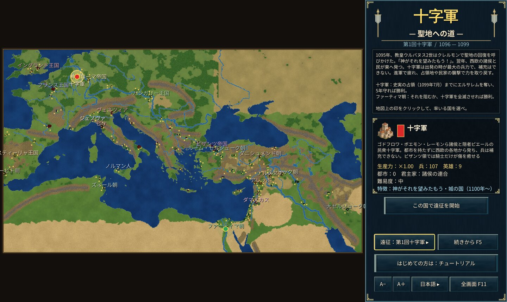

# 十字軍 — 聖地への道（YYCrusaders）

第1・2・3回十字軍を舞台にした、Rust 製の Age of Empires 風リアルタイムストラテジーです。
[YYMongolia](https://github.com/ykwyuta/yyMongolia)（モンゴル帝国）のゲームエンジン（シミュレーション・AI・UI・描画層）を流用し、舞台・国・兵種・英雄・史実の出来事・勝利条件を作り直しました。**ブラウザ版**（WebAssembly + WebGL2）と **Windows 版**（Direct3D11 / Direct2D）を同じゲーム本体から作ります。

**ドキュメント**：紹介とユーザーガイド（[日本語](docs/ja/introduction.md)・[English](docs/en/introduction.md)・[中文](docs/zh/introduction.md)）。



## 遠征（開始時に選ぶ）

タイトル画面の「遠征」ボタンで切り替えます。遠征ごとに地図の範囲・登場する国・実在の都市・英雄・勝利条件が違います。

| 遠征 | 時代・時間 | 地図 | 選べる国 | 勝利条件 |
|---|---|---|---|---|
| 第1回十字軍 | 1096〜1104年（1年＝4分） | 西欧から近東まで | 十字軍・ファーティマ朝 | 十字軍：史実の占領（1099年7月）までにエルサレムを奪い、5年守る。ファーティマ朝：それを阻むか、十字軍を全滅させる |
| 第2回十字軍 | 1148〜1250年（1年＝24秒） | 中近東 | 十字軍・ファーティマ朝・ザンギー朝・セルジューク朝（ルーム）・ビザンツ帝国 | 十字軍：全滅せずにダマスカスを占領する。ほかの国：1250年に最も広い版図を持つ |
| 第3回十字軍 | 1191年6月〜1192年9月（1年＝20分） | レバント沿岸 | 十字軍連合軍・アイユーブ朝 | レバント沿岸の都市（⚓）から相手を駆逐する。決まらなければヤッファの和約で終わる |

- 第2回は十字軍がアッコン・アンティオキアに、第3回はリチャード獅子心王らがアッコンの包囲の陣に**上陸した時点**から始まる。

## ゲームの特徴

- **街は築けない、砦は築ける**：地図の都市はすべて実在の街（約130）。領土を広げるには攻め落とす（実在の都市は焼き払えない）。民で砦（要塞）を築ける。主な都市には始まりから城壁の要塞と兵営がある。
- **船を造れる国は限られる**：イスラームの沿岸国家（ファーティマ朝・アイユーブ朝）、イタリアの海の共和国（ヴェネツィア・ジェノヴァ・ピサ）、ビザンツ帝国だけ。都市を占領しても造れるようにはならない（十字軍には始まりから借りた船がある）。
- **英雄**：召喚の仕組みはなく、その遠征のときに実在した人物（46人）が、仕えていた国の兵として初めから地上にいる。ゴドフロワ・ボエモン・隠者ピエール・アレクシオス1世・ケルボガ、ルイ7世・コンラート3世・ヌールッディーン・マヌエル1世、リチャード獅子心王・フィリップ2世・サラディン・アル＝アーディルなど。討たれれば戻らず、史実の出来事で帰国・暗殺されることもある（「英雄 H」で一覧）。
- **第1回十字軍の消耗**：十字軍は都市を持たず西欧の各地から発つ。出発時が最大兵力で、兵も民も補充できない。敵地の進軍で体力が少しずつ減り、奪った都市の領内や**民家の襲撃**で回復する。ビザンツ領では騎士は癒えるが、民衆十字軍は癒えない。
- **セルジューク諸国**：ルーム・大セルジューク・ダニシュメンド・ダマスカス・アレッポ・アルトゥクは、自領を通る十字軍やファーティマ朝の軍を（宣戦がなくても）迎え撃つ。
- **民家**：都市のまわりの村。焼けば食糧を奪い、近くの兵が回復する。しばらくすると建て直される。
- **兵種（26種）**：騎士・従士歩兵・弩兵・民衆十字軍・テンプル騎士・ホスピタル騎士・トルコポーレ・ヴァリャーグ親衛隊・カタフラクト・トルコ騎射兵・グラーム騎兵・マムルーク・ハルカ親衛騎兵・クルド騎兵・スーダン歩兵・アルメニア弓兵・ナフサ兵、ドロモン（ギリシアの火）・ガレー船・シーニー船など。
- **史実の出来事（約70件）**：聖槍の発見、ファーティマ朝のエルサレム奪回、アスカロンの陥落、ダマスカスの開城、ファーティマ朝の終焉（アイユーブ朝へ）、ヒッティーン、エルサレムの開城、フィリップ2世の帰国、コンラートの暗殺など。
- そのほか YYMongolia と同じく、国ごとの特徴、交易（地中海の道・紅海の道・シルクロード）、部族（ベドウィン・トルクメン・ニザール派など）と傭兵、反〇〇同盟（第2回のみ）、戦場の霧、記録（F5）、チュートリアル（第2回のビザンツ帝国）、日本語・英語・中国語、タッチ操作に対応。

## 遊ぶ・ビルドする

```
bash build.sh                      # dist/ に静的サイトを出力
cd dist && python3 -m http.server 8000
```

ブラウザで http://localhost:8000/ を開く。Windows 版は `cargo run --release --bin yycrusaders-win`（記録は `%APPDATA%\yycrusaders\saves\slot{N}.yycsav`）。Cloudflare への公開は `bash build.sh && npx wrangler deploy`。

## 構成（YYMongolia から変えたところ）

| ファイル | 内容 |
|---|---|
| `src/geo.rs` | 遠征（`Scen`）ごとの地図の投影、地形生成（山脈・砂漠・峠）、国家・実在の都市・遠征の定義 |
| `src/geodata.rs` | 西欧〜近東の海岸線・湖・河川（`tools/geoprep.py` が Natural Earth から生成） |
| `src/world/scenario.rs` | 始まりの配置（守備兵・野戦軍・兵営・城壁の要塞・民家）、第1回十字軍の消耗と回復、民家の襲撃、セルジューク諸国の迎撃、勝敗の判定 |
| `src/world/heroes.rs` | 遠征ごとの実在の英雄 |
| `src/world/history.rs` | 遠征ごとの史実年表（月単位）。都市の奪取・王朝の交代・英雄の退場の効果 |
| `src/world/units.rs`・`traits.rs`・`trade.rs` | 兵種・国の特徴・交易路と部族 |
| `src/ai.rs` | AI。第1回の十字軍は、コンスタンティノープルに集結してニカイア・アンティオキアを経てエルサレムへ進む |
| `src/game/heroes.rs` | 英雄の一覧、地図上の英雄と都市の名札 |

## テスト

```
cargo test --release --lib -- --skip long_sim                 # 単体テスト（勝利条件・消耗と回復・建設の制限・船の制限・陸の道など）
SIM_SCEN=1 cargo test --release long_sim -- --nocapture       # 全国 AI で遠征を通しで回す（SIM_SCEN=1〜3、SIM_PICK=選ぶ国の番号）
YY_MAP_OUT=/tmp/map cargo test --release --lib map_preview    # 3つの地図を PPM に書き出す
```

## 出典

地図の海岸線・湖・河川は [Natural Earth](https://www.naturalearthdata.com/)（パブリックドメイン）の 1:50m・1:10m データを簡略化したもの。ゲームエンジンと絵の素材は [YYMongolia](https://github.com/ykwyuta/yyMongolia) のもの（イスラーム・ラテン・正教の文化圏の絵を使う。英雄の肖像は既存の肖像を割り当てている）。


## ブラウザ版のキャッシュ更新

右下の「↻ キャッシュ更新」で、セーブデータと設定を残したままゲームのキャッシュを更新して再読み込みできます。未保存の進行は戻らないため、必要なら先にF5の記録画面で保存してください。保存処理中は完了を待ち、保存失敗やメモリ上だけの記録がある場合は再読み込みを中止します。通信に失敗した場合も対局画面に留まります。

確認テスト：`node tools/test-browser-recovery.cjs`
