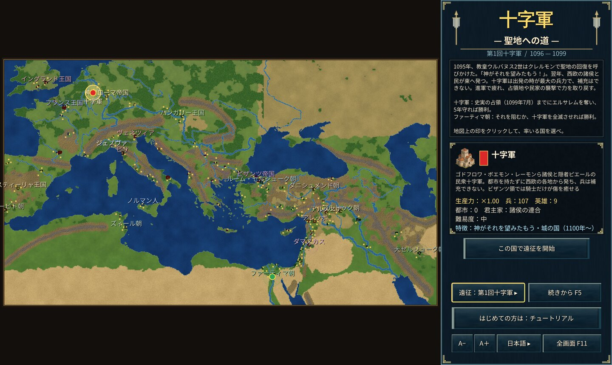

# The Crusades — The Road to Jerusalem

In 1095 Pope Urban II called at Clermont for the recovery of the Holy Land: "God wills it!"

A real-time strategy game set in the First, Second and Third Crusades. Choose a crusade, then lead the crusaders or one of the Muslim states and Byzantium that faced them.

## The crusades

- **First Crusade (1096–1104)**: a map from Western Europe to the Near East. The crusade owns no cities, cannot be reinforced, wears down on the march and recovers in captured lands or by raiding villages (in Byzantine lands only knights heal). Take Jerusalem by July 1099 and hold it for 5 years to win as the crusaders; the Fatimids win by preventing it or annihilating the crusade.
- **Second Crusade (1148–1250)**: a map of the Middle East. The crusaders win by taking Damascus without being annihilated; the Fatimids, Zengids, Seljuks and Byzantium compete for the largest realm in 1250.
- **Third Crusade (1191–1192)**: a map of the Levantine coast, starting at the siege of Acre. Drive the enemy from every coastal city to win; otherwise the war ends with the Treaty of Jaffa.

## Key points

- **No new cities**: every city is a real town and must be captured. Workers can build forts.
- **Ships**: only the Muslim coastal states, the Italian maritime republics and Byzantium can build them.
- **Heroes**: real people such as Richard the Lionheart, Saladin, Godfrey and Nur ad-Din are on the field from the start for the states they served. Press Heroes (H) to see them.
- **Villages**: burn them to seize food and heal nearby troops.

See the in-game Help (F1) and the Tutorial (as Byzantium in the Second Crusade). On Windows run `cargo run --release --bin yycrusaders-win`.
