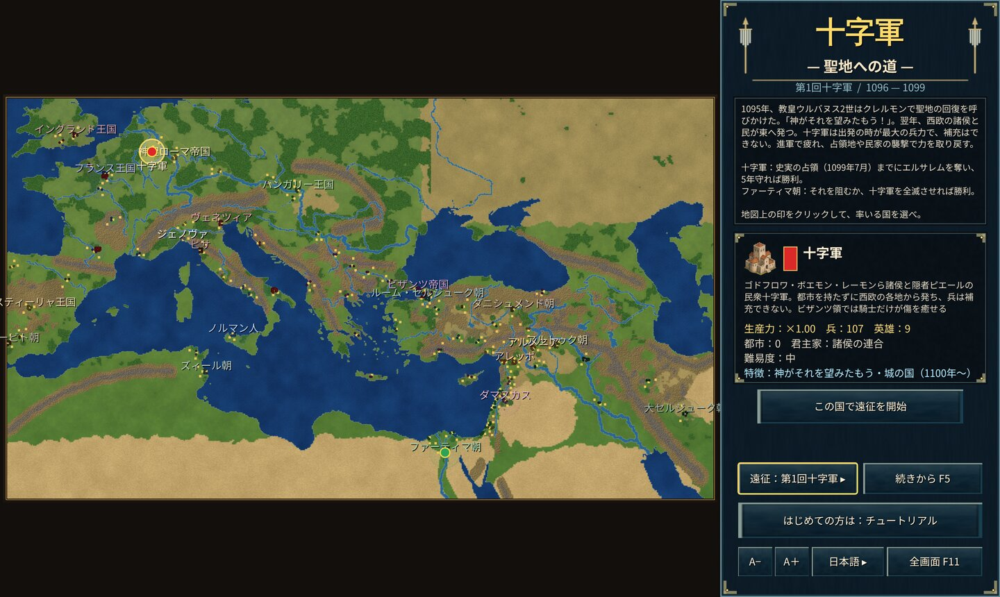

# 十字軍 — 聖地への道

1095年、教皇ウルバヌス2世はクレルモンで聖地の回復を呼びかけた。「神がそれを望みたもう！」——。

本作は、第1・2・3回十字軍を舞台にしたリアルタイムストラテジーです。始めに遠征を選び、十字軍か、それに立ち向かうイスラームの国々・ビザンツ帝国のいずれかを率います。

## 遠征

- **第1回十字軍（1096〜1104年）**：西欧から近東までの地図。十字軍は都市を持たずに西欧の各地から発ち、兵は補充できない。進軍で疲れ、奪った都市の領内や民家の襲撃で回復する（ビザンツ領では騎士だけが癒える）。1099年7月までにエルサレムを奪い、5年守れば十字軍の勝利。ファーティマ朝はそれを阻むか、十字軍を全滅させれば勝利。
- **第2回十字軍（1148〜1250年）**：中近東の地図。十字軍は全滅せずにダマスカスを奪えば勝利。ファーティマ朝・ザンギー朝・セルジューク朝・ビザンツ帝国は1250年の版図を競う。
- **第3回十字軍（1191〜1192年）**：レバント沿岸の地図。アッコンの包囲から始まり、沿岸の都市から相手を駆逐した側が勝つ。決まらなければヤッファの和約で終わる。

## 遊び方の要点

- **街は築けない**：都市はすべて実在の街で、攻め落として手に入れる。砦（要塞）は民で築ける。
- **船**：造れるのはイスラームの沿岸国家・イタリアの海の共和国・ビザンツ帝国だけ。
- **英雄**：リチャード獅子心王・サラディン・ゴドフロワ・ヌールッディーンなど実在の人物が、仕えていた国の兵として初めからいる。「英雄 H」で一覧と居場所を見られる。
- **民家**：都市のまわりの村。焼けば食糧を奪い、近くの兵が回復する。
- **資源と兵**：糧・木・鉄を民が集め、兵営で兵を訓練する。兵の数には上限があり、訓練で1体ずつ強くする。

操作はゲーム内のヘルプ（F1）とチュートリアル（第2回のビザンツ帝国で開始）を参照。

## Windows 版

`cargo run --release --bin yycrusaders-win` で起動するか、GitHub Actions の成果物 `yycrusaders-windows` の `yycrusaders-win.exe` を実行します。記録は `%APPDATA%\yycrusaders\saves` に保存され、ブラウザ版と同じ形式です。
