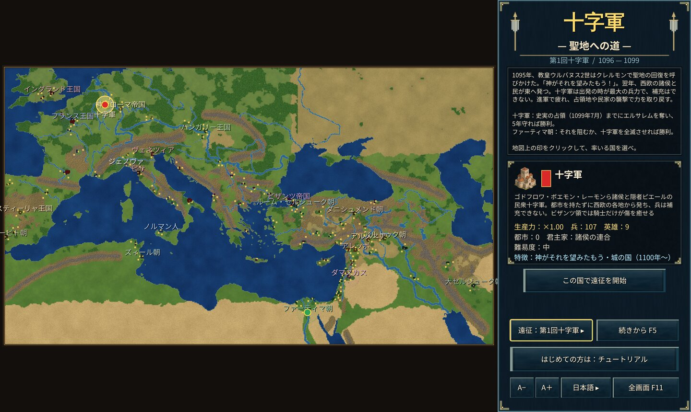

# 十字军 — 圣地之路

1095年，教皇乌尔班二世在克莱蒙号召收复圣地：“这是神的旨意！”

本作是以第一、二、三次十字军为舞台的即时战略游戏。先选择远征，再率领十字军，或与之对抗的伊斯兰诸国与拜占庭帝国。

## 远征

- **第一次十字军（1096〜1104年）**：从西欧到近东的地图。十字军没有城市、无法补充兵力，行军会消耗体力，在攻占的领地或袭击民宅时恢复（在拜占庭领内只有骑士能恢复）。十字军须在1099年7月前夺取耶路撒冷并坚守5年；法蒂玛王朝阻止这一切或全歼十字军即胜利。
- **第二次十字军（1148〜1250年）**：中近东的地图。十字军在不被全歼的情况下攻占大马士革即胜利；法蒂玛王朝、赞吉王朝、塞尔柱王朝、拜占庭帝国角逐1250年的版图。
- **第三次十字军（1191〜1192年）**：黎凡特沿岸的地图，从阿卡之围开始。将敌人逐出所有沿岸城市者胜利，否则以雅法和约告终。

## 要点

- **无法新建城市**：所有城市都是真实城镇，须攻占获得。民可以修筑要塞。
- **船只**：只有伊斯兰沿海国家、意大利海上共和国与拜占庭帝国能造船。
- **英雄**：狮心王理查、萨拉丁、戈弗雷、努尔丁等真实人物从一开始就在其效力之国登场。按“英雄 H”查看。
- **民宅**：焚烧可夺取粮食并恢复附近士兵。

操作请参阅游戏内帮助（F1）与教程（以第二次十字军的拜占庭帝国开始）。Windows 版：`cargo run --release --bin yycrusaders-win`。
